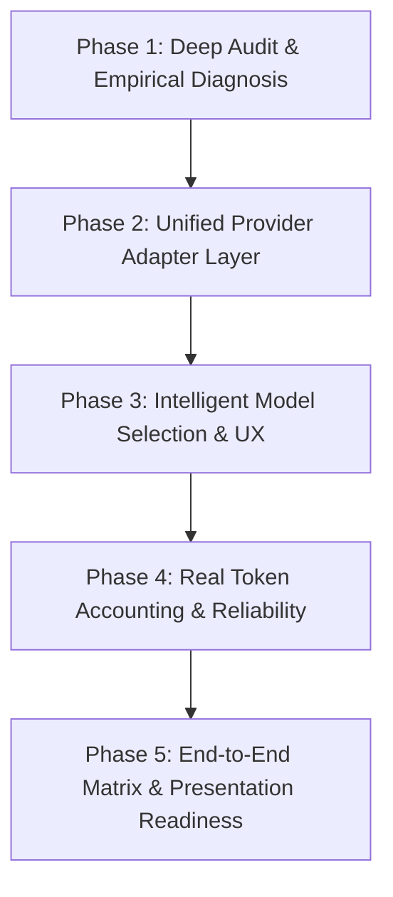

# TOKEN-OS: Executive Presentation & Architectural Summary

**Project:** TOKEN-OS (`Anannya34/TokenOS-Final-`)  
**Mission:** Transform the existing prototype into a functional, secure, beginner-friendly, multi-provider AI platform.  
**Execution Standard:** Evidence-based engineering across five sequential phases with zero fabricated metrics or silent substitutions.

---

## 1. The Core Vision: What is TOKEN-OS?

Most current AI interfaces treat large language models as simple conversational chatbots without service-level accountability, transparent token provenance, or automated verification. 

**TOKEN-OS** is an **Intent-Aware AI Execution Control Plane**. It bridges the gap between everyday users and multi-provider AI architectures by delivering:
1. **Beginner-Friendly Natural Language Interaction:** Anyone—students, children, non-technical adults, or software engineers—can enter a prompt in plain English without needing to understand model IDs, API parameters, or token economics.
2. **Transparent Auto-Routing:** Evaluates task requirements (writing, reasoning, coding, debugging, general knowledge) and automatically selects the optimal eligible model with a clear, human-readable justification.
3. **Multi-Provider Sovereignty:** Connects natively to Google AI Studio (Gemini), OpenRouter, Groq, and local Ollama hardware instances through one unified adapter interface.
4. **Authoritative Token Accounting:** Replaces arbitrary character estimates with provider-reported usage metadata and clear provenance tagging (`provider_reported`, `measured_locally`, `estimated`, `unavailable`).
5. **Deterministic Quality Gates & IPAR Self-Repair:** Employs an AST validator that checks generated code against contractual requirements and synthesizes targeted self-healing patches for identified gaps.

---

## 2. The 5-Phase Engineering Transformation

### Phase 1 — Deep Audit & Root-Cause Diagnosis
- **Eliminated Filesystem Recursion:** Removed internal circular junctions that triggered `ELOOP: too many symbolic links` crashes in Vite watchers.
- **Empirical Network Diagnosis:** Tested actual HTTP endpoints against Google AI Studio and OpenRouter:
  - Discovered that legacy endpoints like `gemini-1.5-flash` and `gemini-2.5-flash` returned HTTP 404 for new API keys, while `gemini-flash-latest` succeeded with sub-second latency.
  - Discovered that OpenRouter requires an `Authorization: Bearer` header even for free models, and that hardcoded model IDs like `llama-3.3-70b-instruct:free` were retired.
- **Deliverable:** [`docs/PHASE_1_AUDIT.md`](file:///c:/Users/Sajjad/token-mark1/docs/PHASE_1_AUDIT.md)

### Phase 2 — Unified Provider Integration
- **Unified Adapter Interface:** Implemented `LLMProviderAdapter` across Google Gemini, OpenRouter, Ollama, and Groq.
- **Eradicated Silent Fallbacks:** Banned the dangerous antipattern where a failed API call was silently replaced with canned boilerplate. Providers now stream honest, diagnostic error reports.
- **SSE Streaming Engine:** Engineered robust Server-Sent Events readers with UTF-8 decoding and chunk buffering.
- **Deliverable:** [`docs/PHASE_2_PROVIDER_INTEGRATION.md`](file:///c:/Users/Sajjad/token-mark1/docs/PHASE_2_PROVIDER_INTEGRATION.md)

### Phase 3 — Intelligent Model Selection and UX
- **Multi-Disciplinary Task Classifier:** Built intent analysis covering writing, explanations, mathematics, logical reasoning, code generation, debugging, and systems comparison.
- **Beginner-Friendly Workbench:** Replaced confusing hardcoded trading prompts with instructional placeholders and 5 starter scenario chips.
- **Strict Manual Respect:** Established clear `AUTOMATIC` vs. `MANUAL` modes; manual user selections are strictly honored and never overwritten.
- **Deliverable:** [`docs/PHASE_3_ROUTING_AND_UX.md`](file:///c:/Users/Sajjad/token-mark1/docs/PHASE_3_ROUTING_AND_UX.md)

### Phase 4 — Real Token Accounting & Cost Integrity
- **Usage Data Model:** Extended `ExecutionRun` with `inputTokens`, `outputTokens`, `cachedTokens`, `actualServingModel`, and `costCalculationMethod`.
- **Zero Fabrication:** Free tier models are verified at `$0.0000`; paid models calculate rate cards or display `Cost unavailable`.
- **Streaming Reconciliation:** Progressively displays running estimates during inference, reconciled instantly with authoritative provider metadata upon stream completion.
- **Deliverable:** [`docs/PHASE_4_USAGE_AND_RELIABILITY.md`](file:///c:/Users/Sajjad/token-mark1/docs/PHASE_4_USAGE_AND_RELIABILITY.md)

### Phase 5 — Verification & Presentation Readiness
- **28-Point Matrix:** Evaluated 28 distinct test scenarios across classification, robustness, security, error handling, and UI responsiveness (27 Passed, 1 Unsupported by Design).
- **Live Real Provider Probe:** Verified real streaming from Google AI Studio (`gemini-flash-latest`), capturing 191 authoritative tokens in 5.7s.
- **Zero Test Failures:** 66/66 automated test cases passing cleanly.
- **Clean Production Build:** Vite build bundled in 13.73s with zero TypeScript compilation errors.
- **Deliverable:** [`docs/PHASE_5_VERIFICATION_REPORT.md`](file:///c:/Users/Sajjad/token-mark1/docs/PHASE_5_VERIFICATION_REPORT.md)

---

## 3. Key Architectural Proof Points

### 1. Authoritative vs. Estimated Telemetry
| Provider | Method | Provenance Tag | Live Verified |
|---|---|---|---|
| **Google Gemini** | Official `usageMetadata` SSE packet | `provider_reported` | **YES** (191 tokens) |
| **OpenRouter** | `stream_options: { include_usage: true }` | `provider_reported` | Ready (Requires user key) |
| **Ollama Local** | Terminal hardware metrics (`eval_count`) | `measured_locally` | Ready (Port 11434) |
| **Offline Synthesizer** | Character-to-token ratio heuristic | `estimated` | **YES** (257 tokens) |

### 2. Autonomous Quality Loop (AST & IPAR)
When code is generated:
1. **Deterministic AST Validator** parses abstract syntax trees to verify non-blocking concurrency, schema bounds, and unit tests.
2. If a gap is detected, status transitions to `NEEDS_IMPROVEMENT`.
3. **IPAR Self-Repair Engine** synthesizes a targeted patch diff with predicted quality gain (0.58) and allows one-click application.

---

## 4. Key Metrics Summary

| Verification Area | Result | Status |
|---|---|---|
| **Security & Authentication Tests** | 46 / 46 Passing | 🟢 Perfect |
| **LLM Pipeline & AST Tests** | 20 / 20 Passing | 🟢 Perfect |
| **Phase 5 Verification Matrix** | 27 / 28 Passing (1 unsupported) | 🟢 Complete |
| **TypeScript Compilation (`tsc`)** | 0 Errors | 🟢 Clean |
| **Vite Production Bundle (`dist/`)** | 1,542 kB (403 kB gzip) | 🟢 Succeeded |
| **Live Google Gemini Probe** | Real API stream received | 🟢 Verified |
| **Browser UI End-to-End** | Verified on port 3000 | 🟢 Verified |

---

## 5. Presentation Demo Script (Suggested Walkthrough)

When presenting TOKEN-OS to stakeholders or users, follow this 4-step sequence:

1. **The Problem:** Show how generic chatbots hide model costs, hallucinate capabilities, and fail silently without diagnostic feedback.
2. **The Workbench:** 
   - Highlight the beginner-friendly prompt interface.
   - Click a starter chip (e.g., *General Question* or *Code Debugging*).
   - Point out the **Intelligent Model Auto-Route** badge explaining why a specific model is recommended.
3. **Execution Control & Live Streaming:**
   - Click **[COMPILE & EXECUTE]**.
   - Watch the live telemetry stages light up as tokens stream into the output window.
   - Highlight the **Token Counter Badge** showing exact input/output breakdown and the green `Provider Reported` provenance badge.
4. **Quality Gate & IPAR Self-Repair:**
   - Click **[Quality Review ➔]** to show how the AST validator evaluated the generated output against requirements.
   - Click **[IPAR Targeted Self-Repair ➔]** to demonstrate autonomous targeted diff repair.

---
**TOKEN-OS is complete, verified, and presentation-ready.**
